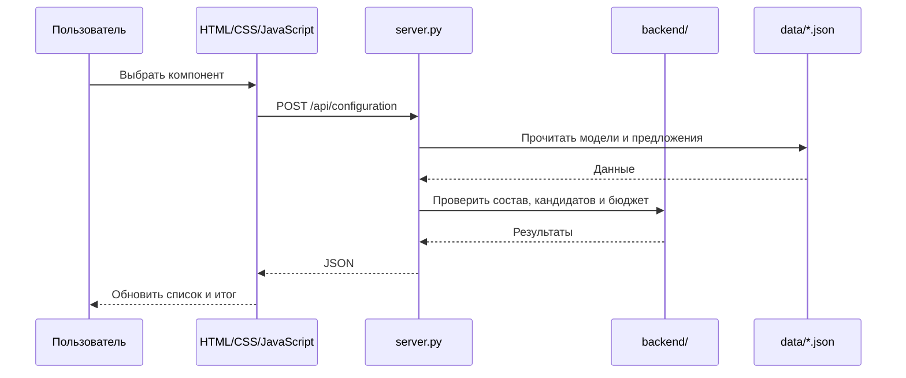

# Фронтенд и бэкенд СОБРАНО

## Что открыть в VS Code

Откройте папку `github/`, а не отдельный HTML-файл. В Explorer видны обе части проекта.

| Файл | Что показать преподавателю |
| --- | --- |
| `index.html` | Главная, общая навигация, поиск и подключение bootstrap |
| `catalog.html` | HTML-основа каталога; содержимое формирует app.js |
| `product.html` | Страница модели по параметру id=pN |
| `builds.html` | Список готовых сборок |
| `build.html` | Подробный состав по id=bN; отличается от списка builds.html |
| `builder.html` | Конфигуратор с выбором компонентов |
| `compare.html` | Сравнение моделей одной категории |
| `favorites.html` | Модели, сохранённые пользователем |
| `about.html` | Объяснение цен, фото, данных и ограничений |
| `css/style.css` | Цветовые переменные, светлая/тёмная темы, сетки и media queries |
| `assets/favicon.svg` | Значок сайта |
| `assets/fonts/` | Локальный Manrope и его лицензия |
| `runtime.json` | Статический режим по умолчанию |
| `js/bootstrap.js` | Чтение runtime, загрузка JSON/API, проверка ответа и запуск модулей |
| `js/app.js` | Рендеринг страниц, формы, поиск, действия, localStorage, экспорт и ссылки |
| `js/backend-client.js` | fetch к Python, POST состава, получение каталога и сборок |
| `js/core.js` | Идентификаторы, категории, характеристики, обработка состава и статическая проверка сборки |
| `js/catalog-ui.js` | Форма фильтров и статические поиск/фильтрация/сортировка |
| `js/compatibility.js` | Статическая оценка кандидата с учётом выбранного состава |
| `js/pricing.js` | Статический выбор снимка цены и подсчёт бюджета |
| `js/product-images.js` | Реестр изображений и соответствие моделям |
| `js/media.js` | Вывод фото, подписи линейки/модели, источники и заглушки |
| `server.py` | Запуск ThreadingHTTPServer, маршруты, валидация запроса, JSON-ответ |
| `backend/__init__.py` | Обозначает Python-пакет backend |
| `backend/catalog.py` | Чтение данных, нормализация товаров, поиск и фильтрация |
| `backend/compatibility.py` | validate_parts, assess кандидата, check всего состава |
| `backend/pricing.py` | Проверка предложений, цены и бюджет |
| `data/catalog.json` | Модели, сборки и метаданные исходных фото |
| `data/offers.json` | Магазин, URL, цена KZT, дата и данные о наличии |
| `tests/*.test.cjs` | Тесты логики статического режима, загрузчика и API-клиента |
| `tests/test_*.py` | Тесты Python, HTTP API, JSON и локальных ресурсов |
| `tests/browser-smoke.cjs` | Проверка реального Chrome без сторонних npm-пакетов |
| `.vscode/launch.json` | Запуск и отладка Python клавишей F5 |
| `.vscode/tasks.json` | Команды запуска и проверок через меню VS Code |
| `.vscode/settings.json` | Скрывает двоичный Python-кэш в дереве редактора |
| `docs/` | Источники, правила совместимости, отчёты и скриншоты |

Повторяющаяся HTML-оболочка у девяти страниц намеренная: каждый раздел имеет прямой адрес и работает на статическом хостинге. Это не девять разных копий бизнес-логики. Общие JS и CSS остаются отдельными модулями.

## Общая схема



Python не рисует кнопки, а CSS не выполняет проверку совместимости. В Python-режиме решения каталога, бюджета и совместимости приходят с сервера. Клиентские модули правил нужны для отдельного статического режима.

## Как хранятся данные

В `catalog.json` строка товара имеет вид `[категория, название, расчётная_цена, массив_характеристик]`. Нормализация превращает её в объект с полями `i`, `id`, `c`, `name`, `price`, `v`, `brand`.

Идентификатор `p0` означает нулевую строку товара; `b0` — нулевую готовую сборку. Состав хранит индексы по категориям: `{"gpu":85}`. Порядок восьми позиций ссылки: CPU, GPU, плата, RAM, накопитель, БП, корпус, охлаждение. Пустая позиция означает отсутствие отдельного компонента.

Значения характеристик зависят от категории. Подписи и единицы перечислены в `js/core.js`, а правила Python читают соответствующие поля в `backend/compatibility.py`. Неизвестное значение не следует заменять выдуманным числом.

Цены предложений отделены от учебных оценок. Пригодный снимок имеет дату, HTTPS-источник, KZT и положительную цену. Устаревшие/будущие снимки и известное отсутствие товара не используются в бюджете. История предложения остаётся видимой.

## API и обработка ошибок

| Запрос | Где обрабатывается |
| --- | --- |
| GET /runtime.json | server.py возвращает python; на статическом хостинге читается файл static |
| GET /api/health | Диагностика реально запущенного процесса |
| GET /api/catalog | JSON плюс результаты цен и готовых сборок |
| GET /api/products | products_payload → catalog.filter_products → compatibility.assess |
| GET /api/builds | builds_payload → проверка задачи и бюджета |
| POST /api/configuration | read_configuration → validate_parts → check, budget и assess для кандидатов |

Параметры каталога: `cat`, `search`, `brand`, `min`, `max`, `sort` и характеристики категории. `parts` передаёт текущий состав, `compat=all` отключает исключение несовместимых моделей, `ids` ограничивает список избранным.

Успех — HTTP 200. Неверный ввод — JSON с `error` и HTTP 400; неизвестный API — 404; неверный метод — 405; слишком большое тело — 413; ошибка данных — 500. Служебные скрытые файлы не раздаются локальным сервером. Интерфейс показывает ошибку и предлагает повтор; при отказе POST прежний состав остаётся.

## Разберите один настоящий пример

При выборе RTX 4090 `js/app.js` вызывает `Backend.prepare`. API-клиент отправляет:

```http
POST /api/configuration
Content-Type: application/json

{"parts":{"gpu":85}}
```

В Python `validate_parts` проверяет, что 85 — целый допустимый индекс именно GPU. Затем `assess` оценивает каждого кандидата. Для p40 (DeepCool PK550D) известная мощность 550 Вт ниже требуемой нижней границы. В ответе `assessments.p40.allowed` равно `false`; конфигуратор исключает этот вариант.

Полный `check.need` при выборе только GPU может оставаться `null`: состав неполон. Это отличается от проверки конкретного слабого БП. Не нужно подменять отсутствие данных окончательным расчётом.

В браузере F12 → Network → Fetch/XHR откройте запрос `configuration`: вкладки Payload и Response. В терминале VS Code виден тот же POST. Поставьте точку останова в `backend/compatibility.py`, функции `assess`, чтобы показать реальные переменные. Подробные шаги F5 находятся в [docs/DEFENSE.md](docs/DEFENSE.md).

## Два способа запуска

Опубликованный фронтенд: https://china1602-glitch.github.io/sobrano/. Репозиторий с обеими частями: https://github.com/china1602-glitch/sobrano.

Открыть исходники: `code "$HOME\sobrano-work\github"`.


Бэкенд и фронтенд вместе:

```powershell
cd "$HOME\sobrano-work\github"
python server.py
```

Адрес: http://127.0.0.1:8080/.

Статический режим:

```powershell
python -B -m http.server 8000 --bind 127.0.0.1
```

Адрес: http://127.0.0.1:8000/. Здесь обработчиков API проекта нет. На GitHub Pages Python также не работает: bootstrap читает JSON и выбирает клиентские реализации. Данные двух режимов общие.

## Вопросы по архитектуре

| Вопрос | Ответ |
| --- | --- |
| Почему не весь код в одном HTML? | Разделение структуры, оформления, интерфейса, данных и серверных правил упрощает проверку и поддержку. |
| Зачем fetch? | Он отправляет запрос без полной перезагрузки страницы и получает JSON. |
| Может ли браузер прислать неверные данные? | Да, поэтому сервер проверяет структуру, категории и индексы независимо от интерфейса. |
| Чем API отличается от JSON-файла? | API выполняет Python-обработку запроса; статический JSON содержит заранее сохранённые данные. |
| Зачем одинаковые правила Python и JS? | Это две реализации для разных способов запуска. Локально используются серверные ответы, на Pages — JS. |
| Почему без SQL? | Каталог небольшой, данные меняются вручную, аккаунтов и заказов нет; JSON достаточно. |
| Где персональные сборки на сервере? | Их нет: текущее состояние хранится в localStorage, передача — ссылка или TXT. |
| Как доказать работу Python? | Показать POST, ответ с запрещённым БП и выполнение assess в отладчике. |

Короткий сценарий выступления — [DEFENSE.md](DEFENSE.md), запуск и тесты — [README.md](README.md).

Полное дерево — [PROJECT_STRUCTURE.md](PROJECT_STRUCTURE.md), публикация и публичная браузерная проверка — [docs/PUBLICATION.md](docs/PUBLICATION.md).
